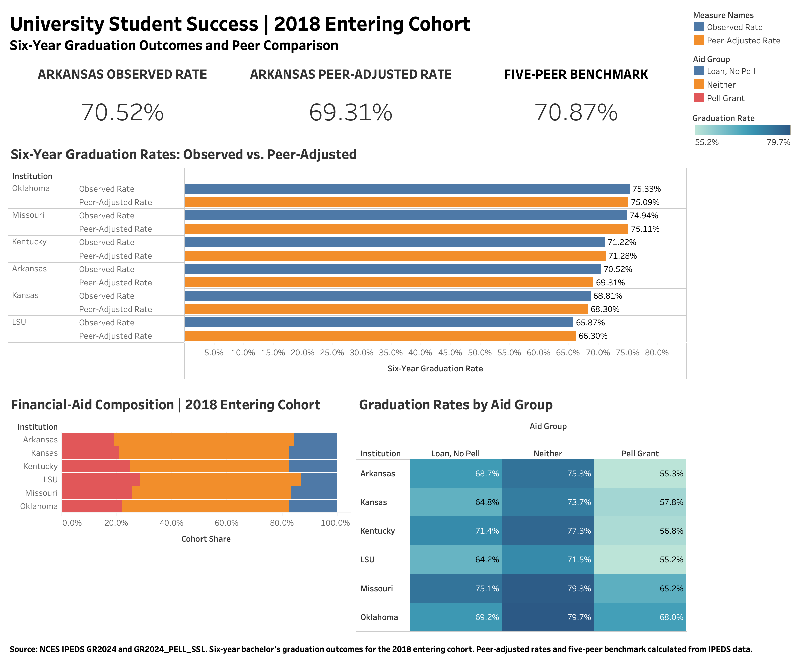

# University Student Success Analytics

**Graduation Outcomes, Financial-Aid Composition & Peer-Adjusted Institutional Performance**

An institutional research project examining six-year bachelor's graduation outcomes at the University of Arkansas and five peer public universities using official IPEDS data.

The analysis compares graduation outcomes across institutions and financial-aid groups, examines changes across entering cohorts, and separates changes in student composition from changes in graduation rates within groups.

## Tableau Dashboard



*Six-year graduation outcomes for the 2018 entering cohort. The dashboard compares observed and peer-adjusted graduation rates, financial-aid composition, and subgroup outcomes across six universities.*

## Key Findings

### 1. Financial-aid composition affects peer comparisons

For the 2018 entering cohort:

| Metric | Graduation rate |
|---|---:|
| Arkansas observed | 70.52% |
| Five-peer pooled benchmark | 70.87% |
| Arkansas peer-adjusted | 69.31% |

Arkansas was 0.35 percentage points below its pooled peers in observed graduation rates. After adjusting Arkansas's financial-aid composition to match the five-peer distribution, the gap was approximately 1.6 percentage points.

### 2. Arkansas improved, primarily through within-group changes

Between the 2014 and 2018 entering cohorts, Arkansas's six-year graduation rate increased by **2.024 percentage points**.

Using symmetric Kitagawa decomposition:

| Component | Contribution |
|---|---:|
| Financial-aid composition | +0.385 pp |
| Within-group graduation rates | +1.639 pp |
| Total change | +2.024 pp |

Approximately 81% of the observed improvement was accounted for by changes in graduation rates within financial-aid groups.

### 3. Arkansas's standardized gap with peers widened

Using a fixed five-peer financial-aid distribution from the 2018 entering cohort, Arkansas's standardized graduation-rate gap moved from approximately −0.11 pp in 2014 to −1.57 pp in 2018.

Arkansas's overall graduation rate improved during this period, but its standardized performance relative to the pooled peer benchmark weakened.

These findings describe differences in aggregate graduation outcomes, not causal effects of institutional policies.

## Data

**Source:** National Center for Education Statistics, Integrated Postsecondary Education Data System (IPEDS).

The study includes six universities:

- University of Arkansas
- University of Kansas
- University of Kentucky
- Louisiana State University
- University of Missouri–Columbia
- University of Oklahoma–Norman

The historical analysis covers five entering cohorts (2014–2018), with six-year graduation outcomes reported from 2020 through 2024.

Students are divided into three mutually exclusive financial-aid groups: Pell recipients, subsidized-loan recipients without Pell, and students receiving neither.

The processed historical dataset contains 90 records at the institution–cohort–aid-group level.

## Analytical Approach

**Direct standardization** compares graduation outcomes under a common financial-aid distribution. The longitudinal analysis uses fixed 2018 peer weights to support consistent comparisons across cohorts.

**Kitagawa decomposition** separates changes in aggregate graduation rates into contributions from financial-aid composition and changes in subgroup graduation rates.

**Data validation** checks cohort definitions, subgroup completeness, derived metrics, source reconciliation, and mathematical consistency. The latest confirmed test run completed with 60 passing tests.

## Tools

- **Python, pandas, NumPy** — Ingestion, transformation, statistical analysis, and validation.
- **pytest** — Automated data-quality and analytical tests.
- **Tableau** — Institutional performance dashboard.
- **Git/GitHub** — Version control.

## Project Structure

```text
config/      Institution configuration
data/        Raw IPEDS data and processed datasets
src/         Data processing and analytical scripts
tests/       Automated tests
dashboards/  Tableau workbook
reports/     Institutional findings and data-quality reporting
docs/        Data sources and metric documentation
sql/         SQL development directories
```

## Reproducing the Analysis

Create a virtual environment and install dependencies:

```bash
python -m venv .venv
source .venv/bin/activate
pip install -r requirements.txt
```

Download the required official IPEDS files described in `docs/data_sources.md` and place them in `data/raw/ipeds/`.

Run the transformation and analytical scripts:

```bash
python src/transform_graduation.py
python src/analyze_peer_adjustment.py
python src/analyze_kitagawa.py
python -m src.analyze_peer_adjustment_historical
```

Run the automated tests:

```bash
python -m pytest tests/ -q
```

Raw and processed datasets are excluded from version control. The published dashboard image documents the visualization; the packaged Tableau workbook is not currently included in the repository.

## Limitations

The analysis uses aggregated IPEDS data and a selected group of five public universities. Financial-aid categories do not account for every difference in student characteristics, and findings may be sensitive to the peer group and reference weights.

Direct standardization and Kitagawa decomposition are descriptive methods. They do not identify the causes of graduation differences or measure the effects of institutional interventions.

## Documentation

- [Data Sources](docs/data_sources.md)
- [Metric Definitions](docs/metric_definitions.md)
- [Data Quality Report](reports/data_quality_report.md)
- [Institutional Brief](reports/institutional_brief.md)
